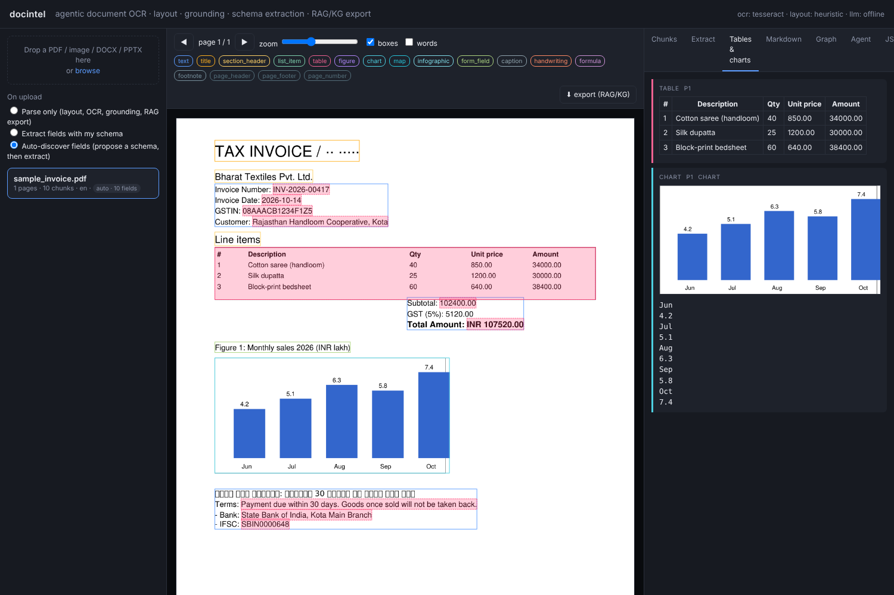

# docintel

**Turn any document into structured, verifiable data — and know exactly where every value came from.**

Give docintel a PDF, a scan, a photo, or an Office file. It gives you back:

- the document's **layout** (titles, sections, paragraphs, tables, charts, form fields…) with a **bounding box for every piece**,
- **tables as real cells** and **charts/maps as data**, not just pixels,
- optionally, the **fields you care about** (invoice number, total, line items, patient name…) as typed JSON — each value
  linked to its **page, box and cropped image snippet**, and independently **verified** against the page,
- everything exported for a **RAG + knowledge-graph** system (including the exact format
  [`ragdoc`](https://github.com/abhisinghh/RAG_over_doc) ingests),
- a **web UI** to inspect all of it on top of the page image.

It works in English, Hindi and other Indic scripts, handles mixed-language pages, and is built to plug in any document
model — hosted API, open weights on your own GPU, or nothing at all (a CPU-only fallback that is good enough for
born-digital PDFs and for running the tests).



---

## 1. Try it in five minutes (no GPU, no API key)

```bash
git clone <this repo> && cd docintel
pip install -e ".[dev]"
sudo apt install tesseract-ocr tesseract-ocr-hin libreoffice   # OCR fallback (+Hindi), Office → PDF conversion

python scripts/make_samples.py samples      # creates a sample bilingual invoice (PDF + scanned PNG)
docintel serve                              # open http://localhost:8080
```

In the browser: drop `samples/sample_invoice.pdf` in, pick **Auto-discover fields**, click the document.
You'll see the layout boxes on the page, the recovered table, the chart, and in the **Extract** tab every discovered
field with its snippet and a ✓ verified mark.

Or from the terminal:

```bash
docintel parse samples/sample_invoice.pdf                      # layout + OCR + grounding only
docintel parse samples/sample_invoice.pdf --mode auto          # also propose fields and extract them
docintel parse samples/sample_invoice.pdf --schema my.json     # extract the fields *you* define
pytest -q                                                      # 29 end-to-end tests, all offline
```

---

## 2. How it works

```
                 ┌─────────┐   ┌────────────┐   ┌───────────────┐   ┌───────────┐   ┌──────────────┐
 any document ─► │ ingest  │ ► │ layout+OCR │ ► │ tables/charts │ ► │   agent   │ ► │  extraction  │ ─► outputs
                 │ render, │   │ (VLM, or   │   │ cells, chart  │   │ re-reads  │   │ schema → typed│    JSON · MD
                 │ text    │   │ Tesseract) │   │ → data, maps  │   │ weak spots│   │ grounded,    │    RAG chunks
                 │ layer   │   │            │   │ → description │   │ & verifies│   │ verified     │    KG triples
                 └─────────┘   └────────────┘   └───────────────┘   └───────────┘   └──────────────┘
```

1. **Ingest** – every page becomes an image. Born-digital PDFs also keep their text layer, which gives exact word boxes
   for free. Office files are converted with LibreOffice.
2. **Layout + OCR** – a document VLM (recommended) or Tesseract + geometric heuristics labels every region
   (`title`, `text`, `table`, `chart`, `form_field`, `handwriting`, …) with a normalised bounding box and the language/script of its text.
3. **Tables, charts, maps** – tables become cells (with row/column spans); charts become data tables + a summary;
   maps/infographics become structured descriptions. So "revenue in Q3 from the chart on page 4" is answerable.
4. **Agent** – looks at the first pass and calls tools only where needed: zoom-read a low-confidence or handwritten
   region, re-OCR a garbled text layer, re-parse a bad page, describe a figure. Every call is logged in a trace.
5. **Extraction** (optional) – you give a JSON Schema; the system retrieves the relevant chunks, extracts values,
   grounds each to a cell or word run, saves a snippet, verifies it against the page, and coerces it to the declared
   type (numbers, ISO dates — including Hindi month names — booleans, enums, arrays of objects such as line items).

Everything speaks one data model (`docintel/schemas.py`): `ParsedDocument → Page → Chunk`, plus `FieldValue`
and `Triple`. If you read one file first, read that one.

---

## 3. Three ways to use it

### Web UI
`docintel serve` → upload → inspect. Colour-coded boxes, click-to-inspect chunks, word boxes, grounded search,
Tables & charts panel, Markdown, Extract tab (paste a schema or click *Suggest schema from document*), Graph tab,
Agent trace, raw JSON, one-click export.

### Command line
```bash
docintel parse <file> [--mode parse|schema|auto] [--schema schema.json] [--out dir]
docintel extract <doc_id> --schema schema.json        # re-run extraction on a parsed document
docintel eval <benchmark> ...                         # see §6
```

### HTTP API
| Call | What it does |
|---|---|
| `POST /api/extract` (multipart `file`, `schema`, optional `mode`) | **one call in, structured result out**: typed fields, groundings, snippet URLs, markdown |
| `POST /api/documents` (`file`, `mode`, optional `schema`) | upload; parsing runs in the background → `{doc_id}` |
| `GET /api/documents/{id}` · `/status` · `/tree` · `/chunks` · `/search?q=` | full parse, job status, section tree, RAG chunks, grounded search |
| `POST /api/documents/{id}/extract` `{"schema": …}` | extract (empty body = propose a schema first) |
| `POST /api/documents/{id}/suggest-schema` | propose a schema from the document |
| `GET /api/documents/{id}/pages/{n}` · `/crops/{chunk}` · `/snippets/{field}` | images |
| `GET /api/documents/{id}/export` | zip with every output below |

### Extraction modes
| Mode | Meaning |
|---|---|
| `parse` (default) | layout, OCR, grounding, tables/charts, exports — no fields |
| `schema` | extract exactly the fields in the JSON Schema you supply |
| `auto` | propose a schema from the document (labels, tables, LLM if configured), then extract; the proposal is returned so you can edit it and re-run deterministically |

A schema can be full JSON Schema (types, `format: date`, `enum`, nested objects, arrays of objects) or just
`{"field_name": "description"}`.

---

## 4. Choosing models (API, open weights, or on-prem)

Two model slots, configured independently, each with a `provider`:

| Slot | Does | `provider` options |
|---|---|---|
| **VLM** – page parsing | layout + OCR + grounding, tables, charts | `openai` (any OpenAI-compatible server or API), `anthropic`, `transformers` (weights in-process), `landingai` (hosted parser) |
| **LLM** – agent & extraction | tool decisions, field extraction, open-IE triples | `openai`, `anthropic`, `transformers`, `none` |

Ready-made configs in `configs/`:

| Config | Setup |
|---|---|
| `offline.yaml` | nothing to install; text layer + Tesseract + heuristics (what the tests use) |
| `dots_ocr.yaml` | **recommended open stack, 1 GPU**: dots.ocr (best open model for Hindi, MIT) for pages + Qwen3-VL-8B for the agent, both via vLLM — `docker compose --profile gpu up` |
| `onprem_transformers.yaml` | air-gapped: one local model loaded in-process, no server |
| `hosted.yaml` | no GPU: a frontier VLM via its OpenAI-compatible API + Claude for extraction |
| `landingai.yaml` | LandingAI ADE parses pages; your LLM extracts |

Select with `DOCINTEL_CONFIG=configs/<name>.yaml` or the `DOCINTEL_*` variables in `.env.example`. Mixing is fine
(e.g. open weights on-prem for OCR, hosted model for extraction). Details and the model landscape: `docs/models.md`,
`docs/design_notes.md`.

---

## 5. What you get for each document

| Output | Use it for |
|---|---|
| `document.json` — pages → chunks with type, text, bbox, confidence, languages, words, table cells, chart data; plus a section `tree` | anything programmatic; the UI |
| `document.md` — markdown in reading order | plain RAG, benchmark scorers |
| `chunks.jsonl` — layout-aware retrieval units with page + bbox + section | LangChain / LlamaIndex |
| `ragdoc_document.json`, `ragdoc_graph.jsonl` | `ragdoc` (`IngestionPipeline.ingest_parsed`) — citations keep page + bbox |
| `triples.jsonl`, `graph.cypher` — KG edges with provenance | Neo4j / NetworkX |
| `extraction.json` — `fields[{name, value, raw_text, confidence, verified, type_ok, context{section,label,row_label,column_header}, groundings[{page,bbox,snippet_path}]}]` | downstream systems, audit |

Feeding `ragdoc`:

```python
from ragdoc.types import ParsedDocument
from ragdoc.ingestion.pipeline import IngestionPipeline
IngestionPipeline(settings).ingest_parsed(ParsedDocument.model_validate(json.load(open("ragdoc_document.json"))))
```

---

## 6. Measuring quality

```bash
docintel eval docvqa --limit 200                         # document QA (ANLS)
docintel eval chartqa --limit 200                        # chart QA (relaxed accuracy)
docintel eval funsd --data FUNSD/testing_data            # forms: text NED + box F1
docintel eval handwriting --data lines.jsonl             # CER / WER on line crops (IAM, IIIT-HW-Dev, yours)
docintel eval extraction --data docs.jsonl --schema s.json   # your own labelled documents: field accuracy + grounding hit-rate
docintel eval omnidocbench --data OmniDocBench/ --out preds/ # writes predictions for the official scorer
docintel eval olmocr-bench --data bench_data/ --out preds/   # idem
```

The benchmark landscape, what the best models score today, and which capabilities need custom training are in
`docs/benchmarks.md`; the plan for this project (including the private bilingual/handwritten test set you will need) is
in `docs/eval_plan.md`.

## 7. When you do need to train

Research conclusion: use pre-trained models for everything **except** Hindi handwriting and your own document schemas.
`training/` has the recipes — a staged TrOCR fine-tune for Devanagari handwriting and a LoRA recipe for schema
extraction on 100–500 labelled documents — plus `export_labels.py`, which turns reviewed docintel outputs into training rows.

---

## 8. Repository map

```
docintel/
  schemas.py              the data model — start here
  pipeline.py             the stages in order (ingest → layout/OCR → tables/charts → agent → extraction → export)
  config.py               settings (env / YAML)
  ingest/loaders.py       file → page images + text layer
  layout/detector.py      region types, word-grid table detection, reading order, DocLayout-YOLO
  ocr/backends.py         Tesseract · VLM (dots.ocr, PaddleOCR-VL, DeepSeek-OCR, generic) · LandingAI · in-process transformers
  tables/extractor.py     cells from word geometry or VLM HTML
  charts/extractor.py     chart → data, map/infographic → description
  extraction/schema.py    schema → grounded, verified, typed fields
  extraction/normalize.py numbers, dates (incl. Hindi), booleans, enums, arrays
  extraction/discover.py  propose a schema from a document (auto mode)
  agents/orchestrator.py  the agent loop and its tools
  export/                 markdown · chunks.jsonl · ragdoc · KG / Cypher
  eval/                   metrics (NED, CER/WER, ANLS, TEDS, box F1) and benchmark runners
  api/server.py           FastAPI + static UI
ui/                       index.html + app.js (no build step)
configs/                  deployment profiles
training/                 fine-tuning recipes and label export
tests/                    29 offline tests incl. fake model endpoints and review regressions
docs/                     models.md · benchmarks.md · architecture.md · eval_plan.md · design_notes.md
```

## 9. Known limits

- No authentication on the API — run it behind your gateway.
- The offline (no-model) mode is a baseline for born-digital documents; scans, photos and handwriting need a VLM.
- Hindi handwriting needs the training recipe; nothing off-the-shelf is reliable yet.
- `teds()` approximates the official APTED scorer; use the official PubTabNet scorer for publishable numbers.
- No real benchmark numbers recorded yet — run §6 with a GPU stack and fill `docs/eval_plan.md`.

Licence: Apache-2.0 for this code. Model licences differ (dots.ocr MIT, PaddleOCR-VL Apache-2.0, Chandra 2 OpenRAIL-M).
